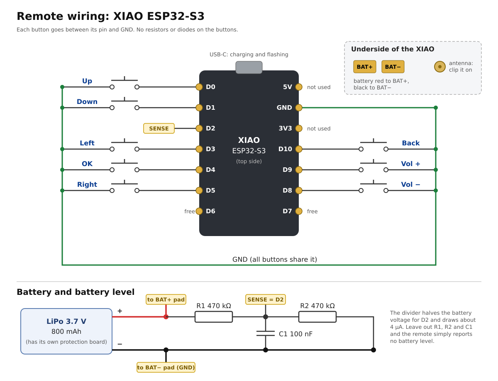

# The remote

A handheld Seeed XIAO ESP32-S3 sends each button press by ESP-NOW to a NodeMCU (ESP8266)
plugged into the TV laptop's USB. The NodeMCU prints each press as a line of
JSON, and the controller sends it on:

- to the video while one plays: OK pauses or resumes, left and right skip ten
  seconds, Back stops;
- to the launcher otherwise, as the arrow, Enter and Escape keys;
- Volume + and − change the laptop's sound (`wpctl`), on any screen.

The firmware is in `firmware/`, one PlatformIO project per board, sharing the
radio packet in `firmware/shared/remote_protocol.h`.

## Flashing

```bash
pio=~/.platformio/penv/bin/pio
$pio run -d firmware/dongle -t upload                   # NodeMCU
$pio run -d firmware/remote -e xiao-bench -t upload     # remote, on the desk
$pio run -d firmware/remote -e xiao -t upload           # remote, in the case
```

The same remote also builds for the ESP32-S3-Zero (`s3zero`, `s3zero-bench`)
and the 30-pin ESP32 DevKit (`devkit`, `devkit-bench`). If a board does not
show up for flashing, hold its **B** (BOOT) button while plugging it in.

After a change to `firmware/shared`, build with `-t clean` first: PlatformIO does
not always notice a changed header there and can flash the old code.

With both boards on USB, the controller finds the dongle by itself (it answers
`?` with a greeting). To pin it, set `"remote": { "port": "/dev/ttyUSB0" }` in
`config/tv.json`; `"enabled": false` turns the remote off.

## Trying it without buttons

Flash the remote with a `-bench` build, then open its serial monitor:

```bash
~/.platformio/penv/bin/pio device monitor -d firmware/remote -p /dev/ttyACM0
```

Typing `u d l r o b + -` sends up, down, left, right, OK, Back, Volume + and
Volume − as if pressed; `!` reports a nearly empty battery, to check the TV's
notice. The bench builds never sleep.

## Wiring the remote (XIAO ESP32-S3)



Each button connects its pin to **GND**; no resistors or diodes. Every button
pin can wake the XIAO from deep sleep, and it knows which one did, so even a
quick tap counts.

| Button | Pin | GPIO |
| ------ | --- | ---- |
| Up     | D0  | 1    |
| Down   | D1  | 2    |
| Left   | D3  | 4    |
| OK     | D4  | 5    |
| Right  | D5  | 6    |
| Vol −  | D8  | 7    |
| Vol +  | D9  | 8    |
| Back   | D10 | 9    |

D6 and D7 (its serial port) are left free.

**Antenna:** clip on the antenna that came with the board. Without it, about
half the presses were lost even with the dongle on the same desk; with it, 48
out of 48 arrived.

**Power:** the 800 mAh LiPo (it has its own protection board) straight to the
**BAT+ / BAT−** pads under the XIAO. The XIAO charges it from its own USB-C port,
which is also the port for flashing; it is safe to plug in with the battery
fitted. Solder a short lead with a connector to the pads once, so the battery
plugs in.

**Battery level (optional):** two 470 kΩ resistors in series from BAT+ to GND,
with the middle point on **D2** (GPIO 3) and a 100 nF capacitor from there to
GND.

## Wiring the remote (ESP32-S3-Zero)

Each button connects its pin to **GND**. No resistors are needed: the chip's own
pull-up resistors hold the pins high, also while it sleeps.

| Button | GPIO |
| ------ | ---- |
| Up     | 4    |
| Down   | 5    |
| Left   | 6    |
| Right  | 7    |
| OK     | 8    |
| Back   | 9    |
| Vol +  | 11   |
| Vol −  | 12   |

GPIO 0, 3, 45 and 46 decide how the chip starts and are left free.

**Power:** the 800 mAh LiPo (it has its own protection board) → the USB-C
charging module's **B+ / B−** → its **OUT+ / OUT−** → the S3-Zero's **5V** and
**GND** pins. The board's own regulator makes 3.3 V from it. The module charges
the cell from its USB-C port.

- Charging current: these modules usually charge at 1 A, set by a resistor
  marked `122` next to the 4056 chip. For an 800 mAh cell, replace it with a
  `242` (2.4 kΩ, about 500 mA).
- Do not plug USB into the S3-Zero while the battery is connected: its USB 5 V
  would feed straight into the module's output. Disconnect the battery to flash,
  or put a Schottky diode (1N5819) from OUT+ to the 5V pin.

**Battery level (optional):** two 470 kΩ resistors in series from OUT+ to GND,
with the middle point on **GPIO 1** and a 100 nF capacitor from there to GND.
Without them the remote reports no level.

## Wiring the remote (ESP32 DevKit, 30 pins)

The same firmware also runs on the DevKit, with buttons to **3.3 V** instead:

| Button | Up  | Down | Left | Right | OK  | Back | Vol + | Vol − |
| ------ | --- | ---- | ---- | ----- | --- | ---- | ----- | ----- |
| GPIO   | 32  | 33   | 25   | 26    | 27  | 14   | 13    | 4     |

Battery level goes to GPIO 34. The DevKit's power LED, regulator and USB chip
draw milliamps while it sleeps; remove the LED and feed its 3V3 pin from a
low-drain regulator (MCP1700-3302) to get months from a charge.

## After a press

The remote stays awake for six seconds, so moving around feels instant, then
measures its battery, reports the level, and sleeps until the next press. The TV
shows "Charge the remote" at 15 % or below, and the admin page shows the level.

## Still to measure

The sleep current, which decides how often the remote needs charging. Measure it
with a multimeter in series with the battery, in its mA or µA range, a few
seconds after the last press. On the XIAO in deep sleep it should be well
under 0.1 mA. On the S3-Zero, its colour LED and regulator are the parts to
suspect if it is above about 0.2 mA.
